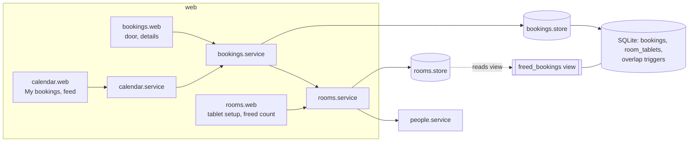
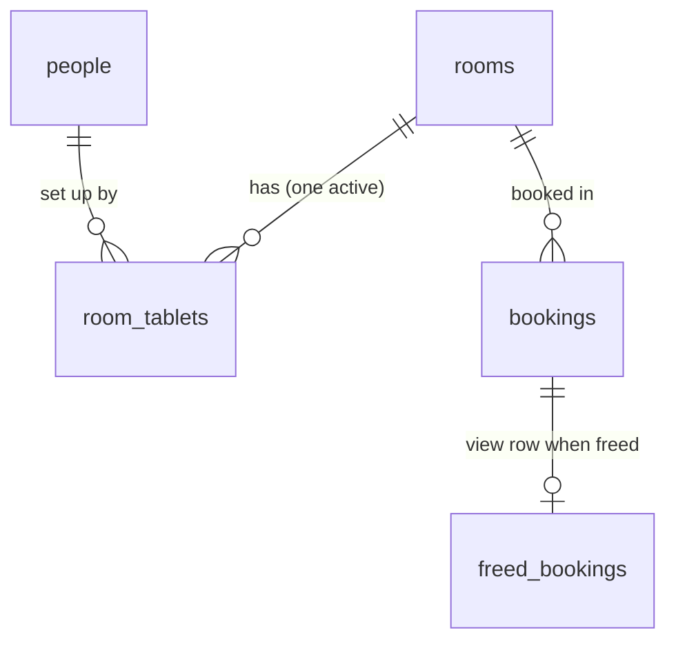
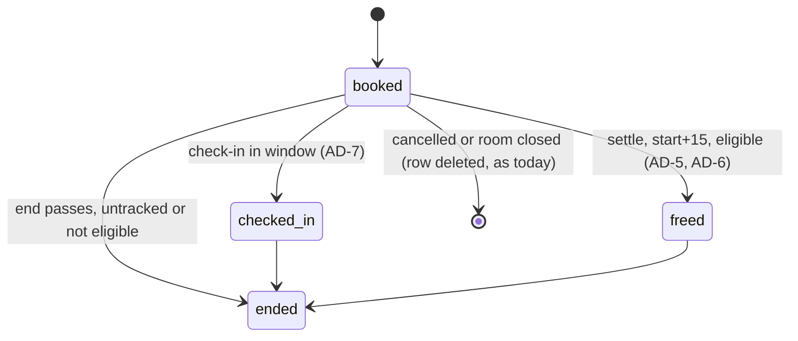

# Architecture Spine — Check-in

## Design Paradigm

A layered modular monolith that already exists. Each module in `roombooker/` has `web.py` → `service.py` → `store.py`, and shared plumbing sits in `roombooker/core/`. Services depend one way only. Where a rule has to hold across modules or across concurrent writers, the database enforces it with triggers, constraints and views. Python never enforces it alone. Check-in adds no module. Its work is split across the existing ones:

| Module | Owns, for this initiative |
| --- | --- |
| `rooms` | door tablets (setup, removal, coverage periods), the weekly freed count on Manage rooms |
| `bookings` | the door page, check-in, freeing, the check-in state of a booking, what a freed booking blocks |
| `calendar` | showing that state on My bookings and in the subscribed feed |
| `core` | `utc_now()`, the `CurrentTablet` dependency |

## Invariants & Rules

### AD-1 — Module boundaries and dependency direction [ADOPTED]

- **Binds:** all
- **Prevents:** `rooms` importing `bookings` to get the freed count, or tablets, or check-in state. Either would create an import cycle against the one-way dependency.
- **Rule:** Service dependencies run `bookings` → `rooms` → `people` and `calendar` → `bookings`, never the reverse. A `web.py` calls only its own service. A `store.py` is imported only by its own service. Door page and check-in routes live in `bookings.web`. Tablet setup and the freed count live in `rooms.web`. Freed display lives in `calendar.web` and in the bookings templates.

### AD-2 — One writer of bookings, under the write lock [ADOPTED]

- **Binds:** R3, R4, C3
- **Prevents:** a check-in and a freeing of the same booking both committing, or a new booking committing against a freed slot whose state is half written.
- **Rule:** Only `bookings.service` writes `bookings` and `booking_attendees`. Check-in and freeing are writes like booking and cancelling. Each runs inside `store.begin_immediate` and re-reads the booking's state after taking the lock. The overlap triggers remain the guarantee against double booking.

### AD-3 — Freed and checked in are recorded, terminal facts

- **Binds:** R3, R4, R5, R6, C3, C6
- **Prevents:**
  - a booking becoming "un-freed" later, for example when its tablet is removed, which would make it overlap the booking that took its slot;
  - the weekly count changing after the fact;
  - the calendar UID changing.
- **Rule:**
  - `bookings` gains two nullable UTC text columns, `checked_in_at` and `freed_at`, with `CHECK (checked_in_at IS NULL OR freed_at IS NULL)`.
  - `freed_at` is always exactly `start_at + 15 min`, never the moment it was written.
  - Once set, neither column is cleared or changed.
  - Check-in and freeing never change `room_id`, `start_at`, `end_at` or `title`.
  - Freeing never deletes the row.

### AD-4 — A booking blocks until `COALESCE(freed_at, end_at)`

- **Binds:** R4, C3
- **Prevents:** the database guard and the advisory checks in Python disagreeing about whether the freed part of a slot is free.
- **Rule:**
  - A new migration replaces `bookings_no_overlap_insert` and `bookings_no_overlap_update`. In the new guard the other booking's end is `COALESCE(other.freed_at, other.end_at)`. The `room_closed` check and the half-open intervals stay as they are.
  - Every availability query uses the same blocking end: `store.overlapping` and its callers `free_rooms`, `bookings_in_slot` and `slot_problem`.
  - Listing queries keep `end_at`, so a freed booking is still listed with its original times: `for_person`, `upcoming_for_organiser` and the feed window.
  - `rooms_close_cancels_future_bookings` is unchanged. A freed booking has started, so a room close keeps it.

### AD-5 — One settler frees bookings; nothing else decides "freed"

- **Binds:** R4, R5, R6, C4
- **Prevents:**
  - the door page, My bookings, the feed and the overlap check each computing "freed" their own way;
  - a second clock;
  - a boundary that tests cannot reach.
- **Rule:**
  - A private `bookings.service._settle(session)` is the only writer of `freed_at`.
  - It runs at the start of every public `bookings.service` function that reads or writes bookings. It does a plain read for due bookings first, and takes `begin_immediate` only when there are some.
  - A booking is due when all of these hold: `checked_in_at IS NULL`, `freed_at IS NULL`, `utc_now() >= start_at + 15 min`, and it is eligible (AD-6).
  - There is no scheduler or background task, and no trigger reads SQLite's `now` for freeing.
  - Every reader takes the freed state from `freed_at` through the view (AD-7).

### AD-6 — Eligibility comes from tablet coverage of the whole window

- **Binds:** R1, R7
- **Prevents:**
  - historical bookings being freed the first time a tablet is set up;
  - the same booking being freed or kept depending on when the settler happened to run.
- **Rule:**
  - A booking is freeable only if a tablet for its room was active for the whole of `[start_at − 5 min, start_at + 15 min)`.
  - `rooms.service` provides each room's tablet periods (`set_up_at`, `removed_at`). `bookings` never reads the tablets table.
  - `[ASSUMPTION]` A tablet set up during a booking's window does not make that booking freeable.

### AD-7 — The check-in window and state live only in `bookings.service`

- **Binds:** R2, R3, R5, R7
- **Prevents:** the door button, the My bookings tag, the details row and the service's refusal disagreeing at the boundary minute.
- **Rule:**
  - The constants `CHECK_IN_OPENS = 5 min` before the start and `FREED_AFTER = 15 min` after it live in `bookings.service`.
  - Check-in is accepted only when `start_at − 5 min <= utc_now() < start_at + 15 min`, the booking isn't freed, and the tablet's room is the booking's room. Repeating a check-in that was already accepted is treated as success.
  - `BookingView` carries `check_in`, one of:
    - `untracked`: the room has no active tablet, or the window isn't covered;
    - `awaiting`;
    - `checked_in`;
    - `freed`.

    It also carries `check_in_opens_at`, `freed_at` and `can_check_in`.
  - Templates, `calendar` and `ical` render these fields and never recompute them. Attendees see the same state as the organiser.

### AD-8 — The door tablet credential

- **Binds:** R1, R3, C2
- **Prevents:**
  - check-in from any desk browser;
  - the person cookie being reused as a device identity;
  - two epics storing or reading the tablet differently.
- **Rule:**
  - `rooms` owns the table `room_tablets` with `id`, `room_id`, `token`, `set_up_by`, `set_up_at` and `removed_at`. Rows are never deleted.
  - The token is `secrets.token_urlsafe(32)`, held in the cookie `door_tablet`: `httponly`, `samesite=lax`, `secure` in production, `max_age` 400 days.
  - The only reader of that cookie is a `CurrentTablet` dependency in `core/identity.py`, which resolves it through `rooms.service` to the tablet's room, or to none.
  - Only an office manager of the room's office sets up a tablet, from that tablet's own browser, through `rooms.service`. They can also remove it.
  - `[ASSUMPTION]` A room has at most one active tablet. Setting up a new one removes the old one at the same instant, so coverage stays continuous.
  - The door page never uses `CurrentPerson` or Pick your name.

### AD-9 — Door routes

- **Binds:** R2, R3, C5
- **Prevents:** tablet setup (rooms epic) and the door page (bookings epic) pointing at different URLs or passing the room in different ways.
- **Rule:**
  - `GET /door` shows the room named by the tablet cookie, with no room id in the URL. Without a valid cookie it shows the "not set up" page.
  - `POST /door/check-in/{booking_id}` checks a booking in, then redirects with a 303 to `/door` (post, redirect, get).
  - Setup redirects to `/door`.
  - These are the only door routes. The page links nowhere else in the app and offers no way to book (Boundaries). It has no QR codes, sensors, badges or notifications (C1).
  - The door page refreshes with an htmx poll that uses `hx-select`, and a meta refresh when JavaScript is off.
  - `[ASSUMPTION]` These path names.

### AD-10 — A freed booking in the calendar is a cancelled event with the same UID

- **Binds:** R5, C6
- **Prevents:** a freed booking re-creating events in existing subscriptions, or vanishing from them in a way that looks like a cancellation.
- **Rule:**
  - A freed booking stays in the feed and in its `.ics` download with an unchanged UID, which AD-3 guarantees. It carries `STATUS:CANCELLED` and `SEQUENCE:1`.
  - Events that aren't freed keep today's output. A cancelled or room-closed booking still drops out of the feed, as today.

### AD-11 — The freed count reads a database view

- **Binds:** R6
- **Prevents:** `rooms` importing `bookings`, which AD-1 forbids, or `rooms.store` reading the `bookings` table's columns directly.
- **Rule:**
  - The migration that adds `freed_at` also creates the view `freed_bookings(booking_id, room_id, freed_at)`. It is the only bookings data `rooms` reads, through `rooms.store`.
  - `rooms.service` counts `freed_at` in `[uk_midnight(week_start(UK today)), utc_now())` for the rooms of an office the actor manages.
  - This is accepted coupling at the database level, the same kind as the close trigger.
  - `[ASSUMPTION]` The count can lag a due booking until the next settle, at most one door refresh (30 s) in a room with a tablet.

### AD-12 — What a freed booking still allows

- **Binds:** R5
- **Prevents:** a freed booking being cancelled, which would delete it from the count and the feed, or a late check-in reviving it.
- **Rule:**
  - `cancel` refuses a freed booking with a new `InvalidBooking` message.
  - Check-in refuses it: the door page shows the closed-window message.
  - Book again still works.
  - Details shows the "Check-in" row from `BookingView.check_in`.

## Consistency Conventions

| Concern | Convention |
| --- | --- |
| Time | `core.time.utc_now()`, called as a module attribute (`clock.utc_now()`), so tests patch one place. Times are stored as UTC text `YYYY-MM-DDTHH:MM:00Z`. UK days and weeks come only from `core.time` (`uk_midnight`, `week_start`). |
| Schema | Changed only by a new Alembic migration (`0005_…`). Each `Table` in a `store.py` mirrors it for queries. No `metadata.create_all`. |
| Pages | Every route works as a full page load. Every POST follows post, redirect, get. htmx only narrows with `hx-select`. |
| Errors | Refusals are `DomainError` subclasses in `core.errors` with user-facing messages, using the wording in the door-screen UX's Voice and Tone. |
| Logging | One log line per check-in, freeing, tablet setup and tablet removal, with ids only. Never log a token. |
| Tests | Window and freeing boundaries are tested by patching `core.time.utc_now` at `start − 5`, `start + 15 − 1 min` and `start + 15`. The close trigger keeps its real-clock tests. |
| Seed and demo | They create no tablets, so existing demo bookings are never freed. |

## Stack

| Name | Version |
| --- | --- |
| Python | 3.14 |
| FastAPI | 0.162.5 |
| SQLAlchemy | 2.1.8 |
| Alembic | 1.20.1 |
| Jinja2 | 3.1.6 |
| htmx | vendored `roombooker/static/htmx.min.js` |
| SQLite | the system library behind Python's `sqlite3` |

## Structural Seed

## Capability → Architecture Map

| Capability / Area | Lives in | Governed by |
| --- | --- | --- |
| R1 tablet setup | `rooms.web` / `rooms.service`, `room_tablets` | AD-8, AD-9 |
| R2 door page | `bookings.web` `GET /door` | AD-7, AD-9 |
| R3 check-in | `bookings.service` | AD-2, AD-7, AD-8 |
| R4 freeing, rest of slot bookable | `bookings.service._settle`, overlap triggers | AD-3, AD-4, AD-5 |
| R5 freed shown to organiser | `bookings` templates, `calendar.web`, `ical` | AD-7, AD-10, AD-12 |
| R6 weekly freed count | `rooms.service` via the `freed_bookings` view | AD-11 |
| R7 no tablet, never freed | tablet coverage periods | AD-6 |
| C4 testable boundary | `utc_now()` only | AD-5, Conventions: Tests |
| C6 feed stability | `ical` | AD-3, AD-10 |

## Deferred

- **The setup screen's flow and wording, and tablet removal UI (R1).** The UX left them out. They belong to the epic, inside AD-8.
- **The freed count's placement and wording on Manage rooms (R6).** Not designed. AD-11 fixes only the data path.
- **Whether a freed booking stays in the Rooms page's "Your upcoming bookings".** The UX left it open. The listings epic decides, inside AD-4 and AD-7.
- **Reconcile the earliest rebooking time with the UX.** UX Flow 2 shows Sam booking at 14:20, but `check_slot` allows only quarter-hour starts that aren't in the past. The earliest is therefore 14:30, which matches R4's "like any free time". Sofia should reconcile the UX when she adopts it.
- **Indexes for the settler's due-booking read.** Add them when a story measures a need.
- **Deployment and environments.** Unchanged: the same app, the same SQLite file, migration `0005` on release. Tablets are browsers on the office Wi-Fi. Rollout to the three offices (Done when) is an operational step, not an architecture decision.
- **Tablet cookie expiry after 400 days.** A tablet then shows "not set up" and is set up again. Revisit if that proves annoying.
