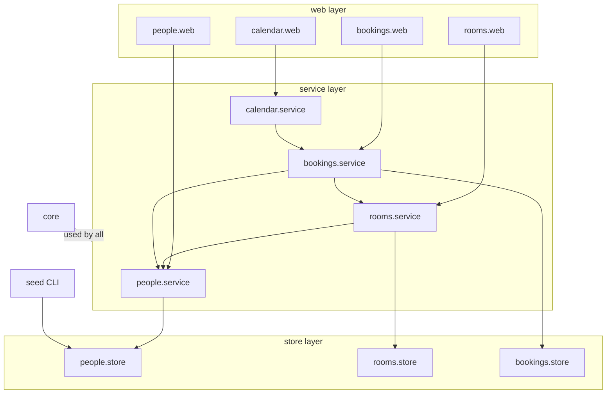
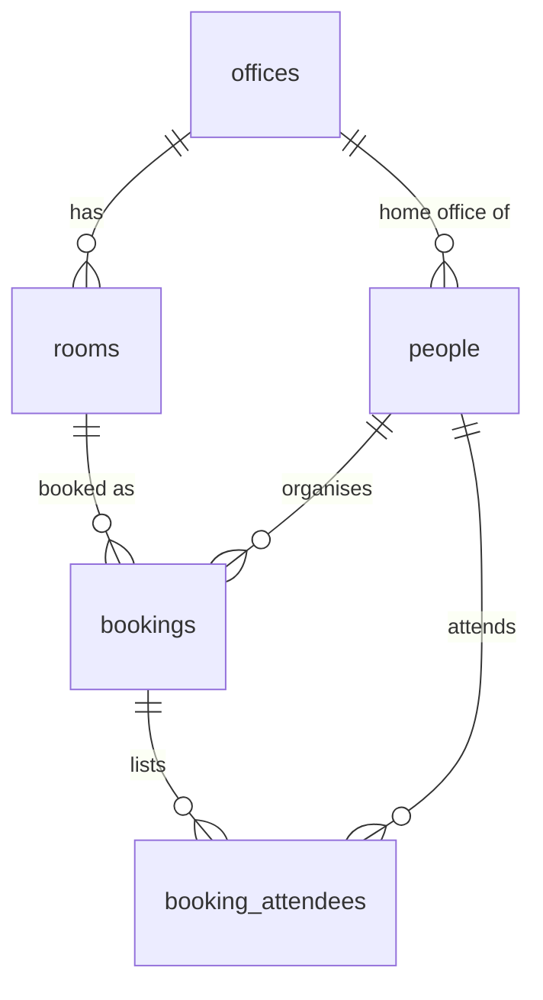
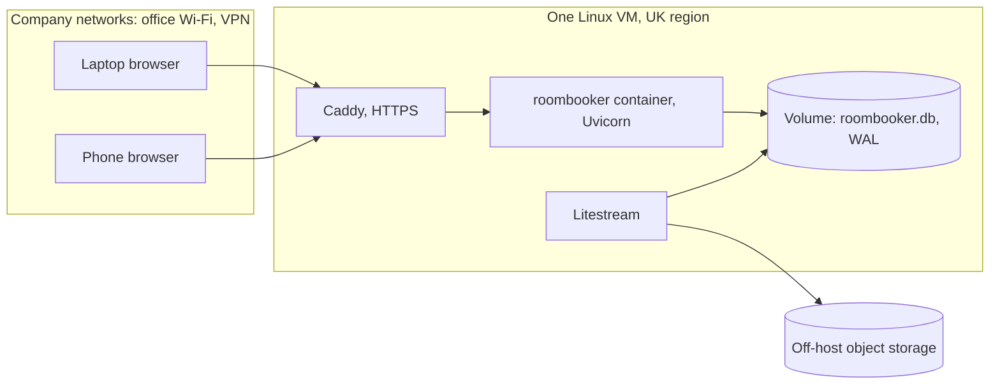

# Architecture Spine — Company Room Booking

## Design Paradigm

**Layered modular monolith.** One FastAPI application, one SQLite database, server-rendered HTML. Four feature modules (`people`, `rooms`, `bookings`, `calendar`), each split into three layers:

| Layer | Holds | Directory |
| --- | --- | --- |
| web | FastAPI routes, Jinja2 templates, form parsing, UK-time formatting | `roombooker/<module>/web.py`, `roombooker/templates/<module>/` |
| service | Rules (RULE-1 to RULE-4), validation, authorisation, domain errors | `roombooker/<module>/service.py` |
| store | SQLAlchemy tables and queries for the tables the module owns | `roombooker/<module>/store.py` |

Shared plumbing (settings, database session, `current_person`, error handler, time helpers) lives in `roombooker/core/`.

## Invariants & Rules



### AD-1 — Layered modules with one-way dependencies

- **Binds:** all epics
- **Prevents:** rules written in routes or templates; one module reading or writing another module's tables
- **Rule:** web calls only its own module's service; services call other services, never another module's store; a store is imported only by its own service (and the seed CLI for `people.store`). Dependencies follow the diagram above and never point upward or in a cycle.

### AD-2 — Server-rendered HTML with htmx `[ASSUMPTION]`

- **Binds:** all epics, R16, RULE-9
- **Prevents:** one epic building a single-page app while another renders HTML; a second codebase and a JS build step
- **Rule:** every surface is a Jinja2 page served by FastAPI. Sheets, panels and refusals are htmx partial swaps (`hx-get`/`hx-post` returning HTML fragments). There is no JSON API and no JS framework or bundler in release one; htmx is a vendored static file. Every route also works on a full page load.

### AD-3 — One owner per table

- **Binds:** R1 to R16
- **Prevents:** two writers of bookings; epic-my-calendar writing its own booking queries
- **Rule:**

  | Tables | Sole writer | Others read through |
  | --- | --- | --- |
  | `offices`, `people` | seed CLI (AD-9) | `people.service` |
  | `rooms` | `rooms.service` | `rooms.service` |
  | `bookings`, `booking_attendees` | `bookings.service` | `bookings.service` |

  `calendar` owns no tables; it gets a person's bookings only from `bookings.service`.

### AD-4 — Overlaps and closed rooms refused by the database

- **Binds:** R5 (booking side), R7 to R11, RULE-1
- **Prevents:** double bookings when two people book at once; a code path (change, office-manager edit, settling a closed room's bookings) that forgets the check
- **Rule:** `BEFORE INSERT` and `BEFORE UPDATE` triggers on `bookings` raise `ABORT` when another row with the same `room_id` satisfies `other.start_at < NEW.end_at AND NEW.start_at < other.end_at` (half-open intervals, so back-to-back bookings are allowed), or when the room is closed. Every booking write runs in a transaction opened with `BEGIN IMMEDIATE`. `bookings.service` turns the abort into `BookingConflict` or `RoomClosed`. A service-level pre-check may run to build the refusal message and the "still free" suggestions, but the trigger is the guarantee.

### AD-5 — Times stored in UTC, shown in UK time

- **Binds:** R6 to R14, RULE-2
- **Prevents:** naive and aware datetimes mixed across epics; daylight-saving bugs; time-zone conversion done in more than one place
- **Rule:** `bookings.start_at` and `end_at` are UTC text `YYYY-MM-DDTHH:MM:00Z`, so text order is time order. Conversion to and from `Europe/London` happens only in the web layer, through `roombooker/core/time.py` (zoneinfo). `bookings.service` checks 15-minute alignment and a length of 15 minutes to 4 hours; the table has `CHECK (end_at > start_at)`.

### AD-6 — One way to know the current person

- **Binds:** R1, R2, RULE-6
- **Prevents:** each epic reading identity in its own way
- **Rule:** the cookie `person_id` holds `people.id`, lasts 400 days, is `HttpOnly` and `SameSite=Lax`, and is not signed (RULE-6: anyone may pick anyone). The FastAPI dependency `core.current_person` is the only reader. It redirects to Pick your name when the cookie is missing or names an unknown or inactive person, then returns the person to the requested page.

### AD-7 — Authorisation lives in services

- **Binds:** R3 to R5, R9 to R11, R13, RULE-3, RULE-4
- **Prevents:** checks that exist only in the UI; epics defining "office manager" differently
- **Rule:** a service function that changes data takes the acting person and raises `NotAllowed` when RULE-3 or RULE-4 fails. Someone is an office manager of office X exactly when `people.is_office_manager` is true and `people.home_office_id = X`. Templates show or hide controls using the same predicates (`can_manage_office`, `can_change_booking`), never their own logic.

### AD-8 — Attendees filtered at the service

- **Binds:** R15
- **Prevents:** the rooms grid, the details panel and the calendar showing attendees to different people
- **Rule:** `bookings.service` returns booking views for a viewer. `attendees` is filled only when the viewer is the organiser, an attendee, or an office manager of the room's office, and is empty otherwise. Templates never load attendees themselves.

### AD-9 — People and offices come only from the seed file

- **Binds:** R1, the user's 2026-11-12 seed decision
- **Prevents:** reloading HR's list changing `people.id`, which would break cookies and bookings; a second import path
- **Rule:** `python -m roombooker.seed <file.csv>` upserts offices and people, keyed on the person's email `[ASSUMPTION]`. A person missing from a later file is marked `active = false`, never deleted `[ASSUMPTION]`. The build seed file and HR's list use the same command and format.

### AD-10 — Schema changes only through migrations

- **Binds:** all epics
- **Prevents:** schema drift between environments; the AD-4 triggers going missing
- **Rule:** every table, index, check and trigger is created by an Alembic migration. `alembic upgrade head` runs as a deploy step before the app starts. Nothing calls `create_all` outside tests.

### AD-11 — One instance, one host, private reach

- **Binds:** OQ-4, RULE-7, RULE-9, the initiative's Done when
- **Prevents:** a second app instance or network storage corrupting SQLite; losing the database; staff names reachable from the internet with no sign-in
- **Rule:**
  - Exactly one app container runs, on one host, with the SQLite file on a local persistent volume.
  - SQLite runs with `journal_mode=WAL`, `busy_timeout=5000` and `foreign_keys=ON`.
  - Caddy terminates HTTPS in front of the app.
  - Litestream replicates the database continuously to object storage off the host.
  - Only company networks (office Wi-Fi and VPN) can reach the app `[ASSUMPTION]`.
  - The host is a small Linux VM in a UK region, run by the company or in the cloud `[ASSUMPTION]`.

### AD-12 — One error path

- **Binds:** R8, R11, all forms
- **Prevents:** each route inventing its own error shape and wording
- **Rule:** services raise `BookingConflict`, `RoomClosed`, `NotAllowed` or `InvalidBooking`. One handler in `core` maps them to 409, 409, 403 and 422 and renders the message fragment in the EXPERIENCE.md voice, inside an `aria-live` region.

### AD-13 — Cancelling deletes `[ASSUMPTION]`

- **Binds:** R11, R12, R13
- **Prevents:** epic-my-calendar having to know about a "cancelled" state invented in epic-find-and-book
- **Rule:** cancelling deletes the booking and its `booking_attendees` rows. `bookings` has no status column. Revisit when OQ-3 (retention) is answered.

## Consistency Conventions

| Concern | Convention |
| --- | --- |
| Naming | Package `roombooker`; tables plural `snake_case`; route paths `/rooms`, `/my-bookings`, `/manage-rooms`, `/bookings/{id}`, `/pick-name` |
| IDs | Integer primary keys; `people.email` is the external key |
| Dates on screen | `14:00`, `Tue 17 Nov`, 24-hour UK time, through Jinja filters in `core/time.py` only |
| Writes | HTML form `POST` only, including change and cancel (`POST /bookings/{id}/cancel`); fragment responses for htmx requests, redirect-after-post otherwise |
| Styling | DESIGN.md tokens as CSS custom properties in `static/tokens.css`; no CSS framework `[ASSUMPTION]` |
| Config | Environment variables read in `core/settings.py` only (`ROOMBOOKER_DB_PATH`, `ROOMBOOKER_ENV`) |
| Logging | stdlib `logging` to stdout; every write logs the acting `person_id`, the action and the target id (evidence for SM-5) |
| Tests | pytest with FastAPI `TestClient` against a temporary SQLite file migrated to head; a concurrency test proves AD-4 |

## Stack

| Name | Version |
| --- | --- |
| Python | 3.14 |
| FastAPI | 0.162.5 |
| Uvicorn | 0.54.0 |
| Jinja2 | 3.1.6 |
| python-multipart | 0.0.33 |
| SQLAlchemy | 2.1.8 |
| Alembic | 1.20.1 |
| SQLite | bundled with Python |
| htmx | 2.0.11 |
| pytest | 9.2.0 |
| httpx | 0.28.1 |
| uv | project and dependency manager |
| Caddy | 2.x, exact version pinned at the deployment story (unverified) |
| Litestream | exact version pinned at the deployment story (unverified) |

## Structural Seed





| Environment | What runs | Data |
| --- | --- | --- |
| Local | `uv run uvicorn`, SQLite file in the repo's ignored `var/` | build seed file |
| Production | AD-11 host | build seed before go-live (office managers enter rooms), then HR's list loaded with the same command |

```text
roombooker/
  core/          # settings, db session, current_person, errors, time
  people/        # web, service, store; pick your name
  rooms/         # web, service, store; manage rooms
  bookings/      # web, service, store; rooms view, booking sheet, details panel
  calendar/      # web, service; my bookings
  seed.py        # CLI for AD-9
  templates/     # base.html shell, one folder per module
  static/        # tokens.css, app.css, htmx.min.js
migrations/      # Alembic, including AD-4 triggers
tests/
deploy/          # Dockerfile, Caddyfile, litestream.yml
```

## Capability → Architecture Map

| Capability / Area | Lives in | Governed by |
| --- | --- | --- |
| R1, R2 pick and switch name | `people`, `core.current_person` | AD-6, AD-9 |
| R3, R4 add and edit rooms | `rooms` | AD-3, AD-7 |
| R5 close and reopen (room side) | `rooms` | AD-7 |
| R5 refuse bookings of a closed room | `bookings`, trigger | AD-4 |
| R6 free rooms by office, date, time, length | `bookings.service` (reads `rooms`) | AD-1, AD-5, RULE-8 |
| R7 book with attendees (making it) | `bookings` | AD-4, AD-5, AD-12 |
| R7 shows in organiser's and attendees' calendars | `calendar` via `bookings.service` | AD-3, AD-8 |
| R8 overlap refused | trigger, `bookings.service` | AD-4, AD-12 |
| R9, R10, R11 change and cancel | `bookings` | AD-4, AD-7, AD-13 |
| R12, R13, R14 my calendar | `calendar` | AD-3, AD-5, AD-7 |
| R15 attendee visibility | `bookings.service` | AD-8 |
| R16 three taps, no typing | `bookings.web` templates | AD-2 |
| RULE-8 under 10 seconds | server-rendered first paint | AD-2 |
| Hosting (OQ-4) | `deploy/` | AD-11 |

## Deferred

- **The fate of a closed room's future bookings:** decided when epic-find-and-book is refined. The AD-4 trigger allows deleting them or moving them to an open room.
- **The exact hosting provider and network restriction:** the user decides with IT. This blocks epic 1's deployment story, not its other stories.
- **Retention of past bookings and attendee lists (OQ-3):** answered before go-live, and may revisit AD-13 or add a purge job.
- **HR file column names:** confirmed with HR. The seed format adapts, and AD-9's email key holds.
- **CI provider, browser end-to-end tool, and monitoring beyond logs and Litestream:** chosen in epic 1's baseline stories.
- **A staging environment:** none planned. Production before go-live is the rehearsal.
