# Company Room Booking PRD

## Table of Contents

- [Document purpose](#document-purpose): readers, altitude, inputs (brief)
- [Vision](#vision): one booking tool for London, Manchester, Leeds
- [Users and journeys](#users-and-journeys): staff, office managers; UJ-1 to UJ-4
- [Glossary](#glossary): office, room, person, office manager, booking, organiser, attendee, closed room
- [Features and requirements](#features-and-requirements): picking your name, rooms, finding a free room, booking, my calendar; FR-1 to FR-14
- [Rules](#rules): no overlaps, booking length, who may change what, trust model, stack; RULE-1 to RULE-7
- [Non-goals](#non-goals): check-in, visitors, catering, desk booking, outside calendars, sign-in
- [MVP scope](#mvp-scope): release one in and out, deferred items
- [Success metrics](#success-metrics): zero overlaps, time to a free room, spreadsheets retired, counter-metric; SM-1 to SM-5
- [Quality and constraints](#quality-and-constraints): speed, laptop and phone; RULE-8, RULE-9
- [Data and compliance](#data-and-compliance): staff names, booking titles, attendees
- [Stakeholders, risks and rollout](#stakeholders-risks-and-rollout): office managers, trust and adoption risks, cutover from spreadsheets
- [Decisions](#decisions): no accounts, standalone, stack, change rights, cutover
- [Open questions](#open-questions): go-live date, booking visibility, data obligations, hosting; OQ-1 to OQ-4
- [Assumptions](#assumptions): unconfirmed inferences A1 to A16, by id

## Document purpose

This PRD states what the first release of Company Room Booking must do, at initiative altitude. Sofia (`bmad-agent-po`) lifts its features into the initiative's Requirements and its rules into Constraints, citing the ids. UX, architecture and the epics decide screens, data model, hosting and edge cases.

It builds on the final brief, `../brief-company-room-booking/brief-company-room-booking.md`: the problem, why now, and the first success criteria. This PRD does not repeat them. Where the brief carried assumptions, this PRD settles the brief's A3, A4, A5 and A8, and part of its A12.

## Vision

Company Room Booking is the one place where anyone in the company finds a free meeting room in London, Manchester or Leeds and books it, with no chance of a double booking. It replaces the three per-office spreadsheets and the rooms named in calendar invites.

The first release is deliberately simple: no accounts, no links to outside calendars. People pick their name and book. Each person sees their own bookings in a built-in calendar, by day and by week. Office managers keep their office's rooms up to date. The company has grown to three offices and more people are back in the office, so the hunting got worse this year. This release ends the double bookings and the hunting, and later releases add sign-in and check-in.

## Users and journeys

- **Staff:** about 300 people, each with a home office. Their job is to get a room for a meeting quickly and trust it will be theirs.
- **Office managers:** some staff are marked as office managers. Their job is to keep their office's rooms accurate and to sort out bookings when needed.
- **Non-users:** visitors and people outside the company.

The four journeys below are drafted from the brief and the user's answers, not from a narrated session; protagonists are roles because the user named no one (unconfirmed, A1).

**UJ-1. A Leeds staff member books a room for this afternoon.** They open the app on their phone; it already knows who they are from their last visit. They see Leeds rooms first, pick 14:00 for an hour, and see which rooms are free. They pick one, give the meeting a title, add two colleagues as attendees and book it. The booking appears in their calendar and in both attendees' calendars. *Failure:* someone else books the same room a moment earlier; the app refuses the booking and shows the rooms still free. Realized by FR-1, FR-2, FR-6, FR-7, FR-8, FR-12.

**UJ-2. A Manchester staff member books a room in London for a visit.** They switch the office to London, pick next Tuesday at 10:00 for two hours, book a free room and add London colleagues as attendees. Realized by FR-6, FR-7, FR-8.

**UJ-3. An organiser moves and cancels meetings.** They open their week view, see a meeting has moved, change its booking to Thursday, and cancel another they no longer need. The room becomes free for others at once. Realized by FR-9, FR-11, FR-12, FR-13, FR-14.

**UJ-4. A London office manager closes a room for repairs.** They open their office's room list, close a room, and later add a newly fitted room. A closed room no longer appears as free. They also move one booking to make room for an urgent meeting, and cancel a booking left behind by someone who has left. Realized by FR-3, FR-4, FR-5, FR-10, FR-11.

## Glossary

- **Office:** one of the company's three sites: London, Manchester, Leeds. An office has many rooms and many people.
- **Room:** a bookable meeting room. It belongs to exactly one office.
- **Person:** a member of staff, already loaded into the app. A person has exactly one home office.
- **Home office:** the office a person belongs to; the app shows it first.
- **Office manager:** a person marked as managing their home office's rooms. An office has one or more.
- **Booking:** a room reserved for a start time and a length, with a title, an organiser and zero or more attendees.
- **Organiser:** the person who made a booking. A booking has exactly one.
- **Attendee:** a person added to a booking. A person can attend many bookings.
- **Closed room:** a room an office manager has taken out of use. It cannot be booked.
- **My calendar:** the built-in view of a person's own bookings, by day and by week.

## Features and requirements

Ordered by dependency. Each feature is a likely epic.

### Picking your name

There are no accounts in release one: a person uses the app by picking their name. Realizes UJ-1.

- **FR-1:** A person can pick their name from the list of loaded people and then use the app as that person.
- **FR-2:** A person can switch to a different name at any time. The app remembers the picked name on that device until the person switches (unconfirmed, A2).

### Rooms

Each office has its own rooms; office managers keep them current. Realizes UJ-4.

- **FR-3:** An office manager can add a room to their office. A room has at least a name and a capacity (unconfirmed, A3).
- **FR-4:** An office manager can edit a room in their office.
- **FR-5:** An office manager can close a room in their office, and reopen it. What happens to the room's future bookings is decided in the epic.

### Finding a free room

Realizes UJ-1 and UJ-2.

- **FR-6:** A person can choose an office, a date, a start time and a length and see which rooms in that office are free. Their home office is shown first, and they can switch to any office.

### Booking

Realizes UJ-1, UJ-2 and UJ-3.

- **FR-7:** A person can book a free room by giving its start time, a length from 15 minutes to 4 hours, a title, and attendees chosen from the loaded people. They become its organiser.
- **FR-8:** The app refuses any booking, or change to a booking, that would overlap another booking of the same room, and says why.
- **FR-9:** The organiser can change a booking's room, start time, length, title or attendees, under the same rules as a new booking.
- **FR-10:** An office manager can change any booking of a room in their office, under the same rules as FR-9.
- **FR-11:** The organiser, or an office manager of the room's office, can cancel a booking; the room is free again at once.

### My calendar

Realizes UJ-1 and UJ-3.

- **FR-12:** A person can see their own bookings in a built-in calendar, by day and by week. Their own bookings include bookings they organise and bookings they attend (unconfirmed, A4).
- **FR-13:** From their calendar, a person can open one of their bookings and, when RULE-3 allows, change or cancel it.
- **FR-14:** A person can move to the previous or next day or week.

## Rules

- **RULE-1:** Two bookings of the same room never overlap in time. No exception.
- **RULE-2:** A booking lasts from 15 minutes to 4 hours. Start times and lengths move in 15-minute steps (unconfirmed, A5).
- **RULE-3:** Only a booking's organiser and the office managers of the room's office may change or cancel it.
- **RULE-4:** Only office managers may add, edit, close or reopen rooms, and only in their own office, which is their home office (unconfirmed, A6).
- **RULE-5:** A closed room cannot be booked.
- **RULE-6:** Release one has no accounts or passwords. A person is whoever picked that name, and anyone can pick anyone's name. The company accepts that trust for release one; sign-in comes later.
- **RULE-7:** The app is built with Python, FastAPI and a SQLite database. The user's computer is for building and testing; where the app runs for the company is decided in the architecture.

## Non-goals

Release one does not include, and no epic adds:

- **Check-in** at the room, or freeing rooms nobody turns up for. The brief names no-shows as the next problem to solve.
- **Visitors** or bookings for people outside the company.
- **Catering**, equipment requests or room set-up.
- **Desk booking.**
- **Links to outside calendars:** no Outlook, Google or other calendar sync, invites or feeds. The built-in calendar is the only calendar.
- **Notifications:** no email, push or other messages; attendees find bookings in their calendar (unconfirmed, A7).
- **Accounts, passwords or sign-in** of any kind, including single sign-on.
- **Loading or editing people or offices.** They are already loaded; changing them is outside the app (unconfirmed, A8).
- **Recurring bookings.** (unconfirmed, A9)
- **Displays outside rooms and usage reports.** (unconfirmed, A10; from brief A12)

## MVP scope

**In release one:** all five features above (picking your name, rooms, finding a free room, booking, my calendar) for all three offices, on laptop and phone.

**Out, with where it goes:**

- Sign-in: a later release (user).
- Check-in and freeing no-show rooms: the next release, per the brief.
- Recurring bookings: a later version, once release one shows how much people rebook by hand (unconfirmed, A9).
- Hosting for the company: decided in the architecture, not in this PRD.

This is already lean: five capabilities that answer the brief's two success criteria and nothing else, so I'm not proposing cuts.

## Success metrics

- **SM-1: No double bookings.** Current: double bookings happen; no count is known. Target: zero overlapping bookings after go-live. Validates FR-8, RULE-1.
- **SM-2: A free room in seconds.** Target: under 10 seconds from opening the app to seeing a free room for a given office and time (unconfirmed, A11; brief A9). Validates FR-1, FR-6.
- **SM-3: Spreadsheets retired.** Target: no office uses its spreadsheet for new bookings four weeks after go-live (unconfirmed, A12; brief A10). Validates FR-7, FR-12.
- **SM-4: Stop signal.** If, six weeks after go-live, people still book in spreadsheets or only in invites, stop and find out why before building more (unconfirmed, A13; brief A11).
- **SM-5: Counter-metric to the no-login choice (RULE-6).** The number of bookings someone says were made or changed under their name without them. Target: none reported by office managers in the first six weeks; any report brings sign-in forward (unconfirmed, A14).

## Quality and constraints

- **RULE-8:** A person sees free rooms for a given office and time in under 10 seconds from opening the app, so the tool beats checking a spreadsheet (unconfirmed, A11).
- **RULE-9:** Every feature works in a browser on a laptop and on a phone, so staff can book away from their desk.

All three offices are in the UK, so the app uses one time zone, UK time (unconfirmed, A15).

## Data and compliance

The app holds staff names, each person's home office and office-manager mark, and every booking's room, time, title, organiser and attendees. Release one has no sign-in, so anyone who can open the app can see what it shows. Who can see booking titles and attendees, and how long past bookings are kept, are open (OQ-2, OQ-3). No regulation was named.

## Stakeholders, risks and rollout

**Stakeholders:** the user owns and decides. The office managers in London, Manchester and Leeds check their room lists before go-live and handle problems after.

**Risks:**

- **Someone books under another person's name**, by mistake or on purpose (RULE-6). *Mitigation:* every booking shows its organiser; SM-5 watches for it; sign-in comes later.
- **People keep using spreadsheets or invites.** *Mitigation:* freeze the spreadsheets at go-live; SM-3 and SM-4 watch for it.
- **Hosting is undecided**, so all three offices may not reach the app at go-live. *Mitigation:* the architecture decides it before the first build (OQ-4).

**Rollout:** one go-live date for all three offices, as the brief's premises set (unconfirmed, A16). Before go-live, office managers check their offices' rooms are loaded and correct. On go-live, the three spreadsheets are frozen for new bookings and each organiser re-enters their own future bookings. The go-live date is not set (OQ-1).

```mermaid
gantt
    title Rollout, relative to go-live (date not set, OQ-1)
    dateFormat X
    axisFormat week %W
    section Before
    Hosting decided (architecture)     :a1, 0, 7d
    Office managers check room lists   :a2, after a1, 7d
    section Go-live
    Spreadsheets frozen, organisers re-enter future bookings :b1, after a2, 7d
    section After
    SM-3 check, spreadsheets retired   :c1, after a2, 28d
    SM-4 stop-signal review            :c2, after a2, 42d
```

## Decisions

- **No accounts in release one:** people pick their name; beat sign-in now. Revisit when SM-5 reports misuse, or in the next release.
- **Standalone, no outside calendars:** the built-in calendar is the only one; beat calendar sync.
- **Stack: Python, FastAPI, SQLite:** chosen by the user. Hosting deferred to the architecture.
- **Change rights:** organiser plus office managers of the room's office. Beat "anyone" and "organiser only".
- **Cutover:** freeze spreadsheets at go-live; organisers re-enter their own future bookings. Beat office managers bulk-loading them.
- **Overlaps never allowed:** no override, even for office managers.

## Open questions

- **OQ-1: Go-live date.** Owner: user. Needed before rollout planning. Blocks the rollout.
- **OQ-2: Who sees booking details?** Can everyone see every booking's title and attendees, or only that a room is taken? Owner: user. Needed by UX. Affects FR-6, FR-12.
- **OQ-3: Data obligations.** How long are past bookings kept, and does any data-protection duty apply to staff names and attendee lists? Owner: user. Needed before go-live.
- **OQ-4: Where the app runs for the company,** so all three offices reach it on laptop and phone. Owner: `bmad-architecture`. Needed before the first build. Affects RULE-7, RULE-9.

## Assumptions

Proposed by John and not yet confirmed by the user; the user chose to finalize without walking them. Each stays open until confirmed, and the PRD is revisited after each epic lands.

- **A1 · UJ-1 to UJ-4:** the journeys are drafted, not narrated; protagonists are roles.
- **A2 · FR-2:** the app remembers the picked name on that device.
- **A3 · FR-3:** a room has at least a name and a capacity.
- **A4 · FR-12:** a person's calendar includes bookings they attend, not only those they organise.
- **A5 · RULE-2:** start times and lengths move in 15-minute steps.
- **A6 · RULE-4:** an office manager's own office is their home office.
- **A7 · Non-goals:** no notifications of any kind.
- **A8 · Non-goals:** loading or editing people and offices is outside the app.
- **A9 · Non-goals, MVP scope:** recurring bookings are out of release one.
- **A10 · Non-goals:** displays outside rooms and usage reports are out (brief A12).
- **A11 · SM-2, RULE-8:** the 10-second threshold (brief A9).
- **A12 · SM-3:** the four-week deadline for retiring spreadsheets (brief A10).
- **A13 · SM-4:** the six-week stop signal (brief A11).
- **A14 · SM-5:** the counter-metric and its trigger for bringing sign-in forward.
- **A15 · Quality and constraints:** one UK time zone for all three offices.
- **A16 · Rollout:** one go-live date for all three offices.
